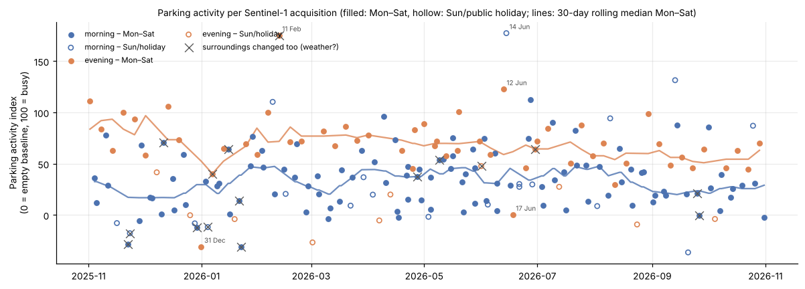
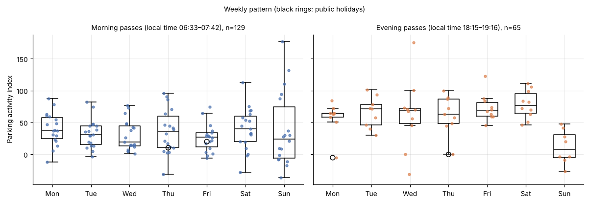
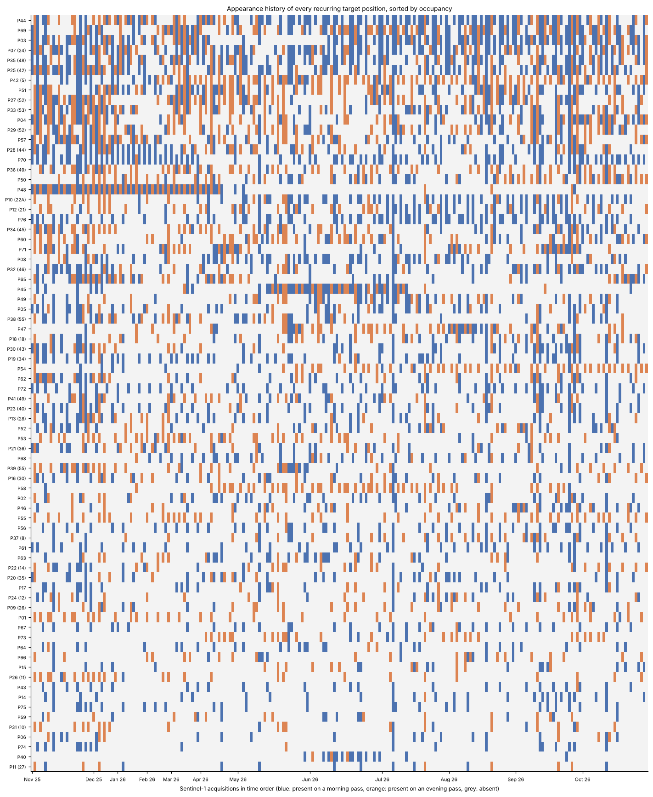

# s1lot — parking-lot activity and individual targets from Sentinel-1 radar

`s1lot` measures how busy a parking lot is over time using free Copernicus
**Sentinel-1** C-band SAR images. Radar works at night and through cloud, so
every pass counts: in Europe that is about one image every two days.

It runs on open data only. You need no account, no API key and no SNAP. It reads
**Sentinel-1 GRD** scenes straight from the public AWS archive. For each scene it
downloads only a few MB around the lot from the cloud-optimised GeoTIFFs, then
calibrates and geocodes them itself.

```
find lot ──► discover scenes ──► calibrate + geocode ──► activity metrics ──► report
(Overture)   (s3://sentinel-s1-l1c)  (σ⁰, noise removal,     (per-track baseline,    (HTML, CSV,
                                      10 m UTM grid)          VH excess, maps)        PNG)
```

## Example: Globus hypermarket car park, Rüsselsheim am Main (DE)

The example is a 6 ha open-air customer car park at the Globus hypermarket in
Rüsselsheim am Main (Am Steinmarkt 1). It was chosen because there is a **known
pattern to check against**: German law keeps the store **closed on Sundays and
public holidays**.

**Data:** one year, Nov 2025 – Oct 2026. **194 acquisitions** from Sentinel-1A, -1C and -1D on three
tracks:

- one evening track (A015, 18:15–19:16 local time);
- two morning tracks (D066 and D139, 06:33–07:42 local time).

The finished report is in
[`runs/globus_ruesselsheim/report/report.html`](runs/globus_ruesselsheim/report/report.html),
with the per-scene data in [`timeseries.csv`](runs/globus_ruesselsheim/report/timeseries.csv).




**Results.** Activity index: 0 = empty baseline, 100 = busy.

| Evening pass (18–19 h) | Mon | Tue | Wed | Thu | Fri | Sat | **Sun** |
|---|---|---|---|---|---|---|---|
| median activity | 64 | 71 | 69 | 63 | 68 | **77** | **8** |
| scenes | 9 | 9 | 10 | 9 | 10 | 10 | 8 |

**How this compares with what we know about the store:**

- **Closed versus open evenings.** On evening passes the lot is +1.1 dB brighter in VH on opening days than on
  closed days. As a median activity index that is 70 versus −2. A one-sided Mann–Whitney test gives
  p = 2·10⁻⁶ (55 open evenings, 10 closed).
- **Saturday is the busiest day**, as expected for a hypermarket.
- **Public holidays look like Sundays.** Christmas Day (−0.2) and Easter Monday (−5) both read as empty.
  These dates come from the `holidays` package for Hesse.
- **The quietest evening of the year is New Year's Eve at 18:16.** German supermarkets close early that
  day.
- **Morning passes (06:30–07:40) have no weekly cycle.** That fits, because the store is barely busy
  at that hour.

The tool also flags acquisitions that don't fit the usual pattern. Examples are the weekday evening of
17 Jun 2026, which looks empty, and the Sunday morning of 14 Jun 2026, which looks very busy (a car-boot
sale or another event?). It also marks scenes where the surroundings changed too, which suggests weather.

## Individual targets over time: aircraft at Helsinki-Vantaa (EFHK)

`s1lot targets` detects individual bright targets in every scene, such as aircraft, trucks or containers. It
groups them into recurring positions, for example aircraft stands, and records when each position is occupied.

```bash
s1lot run     examples/helsinki_vantaa/site.yaml --workdir runs/helsinki_vantaa --start 2025-11-01 --end 2026-10-31
s1lot targets examples/helsinki_vantaa/site.yaml --workdir runs/helsinki_vantaa
```

**How it works:**

1. **Background:** per track, the empty background is each pixel's 10th percentile over time (VV+VH). Fixed
   structures such as terminals, jet bridges and masts are part of the background, so they are not detected.
2. **Detection:** a target is at least 2 connected pixels that are ≥ 7 dB above the background and ≥ −2 dB in
   absolute terms, inside the apron polygons.
3. **Positions:** the recurring positions are peaks of the detection-density map, at least 40 m apart.
4. **Presence:** for each position, every scene is classed present or absent from the strongest pixel within
   25 m.
5. **Long stays:** runs where a position is occupied for 10 days or more.
6. **False alarms:** the same detector runs on vegetation (Overture land cover) away from taxiways and runways,
   where no target can be.

The search area is the apron polygons from Overture/OSM. Positions are labelled with the nearest OSM gate.

**Example run:**

- 231 Sentinel-1 scenes over one year, from five tracks (three morning, two evening).
- 6,862 detections, a median of 25 per scene.
- 76 recurring positions and 70 long stays.

Outputs are in [`runs/helsinki_vantaa/targets/`](runs/helsinki_vantaa/targets/targets.html): the report and
`detections.csv`, `positions.csv`, `presence.csv` (positions × scenes) and `long_stays.csv`.



**Validation: what it shows and what it doesn't.** Without flight records, a check that the radar targets are
aircraft has to rely on indirect evidence:

| Check | Result | Verdict |
|---|---|---|
| False alarms on vegetation vs detections on aprons | 2.4 vs 12.6 per km² per scene | Most detections are real objects; at most about 19% could be noise |
| Positions within 80 m of a mapped gate | 40% of positions vs 12% of random apron points (p = 3·10⁻⁵) | Detections cluster at stands |
| Positions vs aircraft in Sentinel-2 images (visual) | Several positions on the southern pier coincide with aircraft in the optical image | Geometry is consistent |
| Sentinel-2 (12:50 local) bracketed by radar passes that agree | A white object in 14% of cases when the radar says present, 11% when it says absent | **Not confirmed** |
| Long stays vs Sentinel-2 brightness inside/outside the stay | 25 of 48 brighter inside (p = 0.55) | **Not confirmed**. The bright long stays are in winter: likely **snow piles** |

**Conclusion.** The tool reliably finds bright objects that appear and disappear at aircraft stands. However:

- It **can't tell an aircraft from a ground vehicle, de-icing rig or snow pile.**
- With the free data available here, the detections **can't be independently confirmed as aircraft.**
- Sentinel-2 images are taken 5–6 hours away from the radar passes and are too coarse (10 m) to settle it.

A real validation needs flight records (ADS-B, for example from OpenSky; that network was blocked here) or a few
high-resolution images taken at the radar pass times.

**Specific limits:**

- **Contact gates:** aircraft that are almost always parked at a gate become part of the background and are
  missed.
- **Neighbouring stands:** aircraft on adjacent stands can merge into one target.
- **Winter:** snow clearing adds many false targets from November to April.

## How it works

1. **Lot outline.** `s1lot find-lots` queries mapped parking polygons from
   [Overture Maps](https://overturemaps.org), which is derived from OpenStreetMap. It also lists named
   places nearby, so you can identify the lot. You can also give any GeoJSON outline instead.
2. **Scene discovery** (`s1lot/catalog.py`). The AWS archive has no spatial index. Sentinel-1 flies a
   dawn–dusk orbit, so a site is imaged at fixed times of day.
   - A bootstrap step checks product footprints near 06:00 and 18:00 local solar time on a few sample
     weeks. This finds the time of day of every track that covers the site.
   - The full period is then swept, looking only at products within ±2 min of those times.
   - Daily listings and footprints are cached.
3. **Radiometry** (`s1lot/safe.py`). σ⁰ = (DN² − noise) / A², using the product's
   calibration LUT and its range × azimuth thermal-noise LUTs.
4. **Geometry** (`s1lot/geocode.py`).
   - A local model, quadratic in position and linear in height, is fitted to the nearest geolocation
     tie points. It maps lon/lat/height to image line/pixel.
   - Height matters because GRD images are in ground range: 100 m of terrain moves a target by about
     12 pixels. The fit residual is about 0.5 px.
   - The image is resampled onto a fixed 10 m UTM grid, so every scene shares the same pixels.
5. **Activity** (`s1lot/metrics.py`).
   - Empty asphalt reflects radar away from the sensor and looks dark. Parked cars form corner
     reflectors and multiple-bounce echoes and look bright.
   - These echoes depolarise the signal, so **VH (cross-pol) is the default**.
   - Brightness depends on viewing geometry, so everything is compared *within a track*:
     - `excess_db` is the lot's median σ⁰ minus that track's empty baseline (its 10th percentile over
       time).
     - `activity` scales the excess so that 100 is the 95th percentile.
   - For the maps, each pixel's speckle-filtered σ⁰ is tested against its own baseline. This shows which
     parts of the lot fill up most often.
6. **Quality control.**
   - Scenes are flagged where the reference ring around the lot also changed by more than 1 dB. This
     indicates rain, frost or snow.
   - Anomalies are given as robust z-scores against scenes of the same pass and day type.
   - Tracks with fewer than 8 scenes are marked `low_confidence`.

### Choosing the metric

The example lot was used to compare candidate metrics. The score is the AUC for open versus closed
evenings, where 1.0 means perfect separation.

| Metric | AUC |
|---|---|
| Lot median VH (chosen) | **0.96** |
| Lot mean VH | 0.95 |
| Lot median VV | 0.86 |
| Pixel "occupied" fraction (VV, 3 dB) | 0.77 |
| Lot minus surroundings | 0.62–0.82 |

Normalising by the surroundings made results *worse*. Roads and neighbouring shops are busy at the same
times as the lot, so the surroundings carry some of the same signal.

## Install

```bash
pip install -e ".[all]"   # rasterio, pyproj, shapely, pandas, matplotlib, scipy + pyarrow, holidays
```

## Usage

```bash
# 1. Find a lot (Overture Maps) and write its outline
s1lot find-lots --lon 8.3899 --lat 49.9683 --radius 600 --places --out my_site/lot.geojson

# 2. Describe the site (see examples/globus_ruesselsheim/site.yaml)

# 3. Run everything: discover -> process -> analyse
s1lot run my_site/site.yaml --workdir runs/my_site --start 2025-11-01 --end 2026-10-31

# or step by step (each step is cached / resumable)
s1lot discover my_site/site.yaml --workdir runs/my_site --start 2025-11-01 --end 2026-10-31
s1lot process  my_site/site.yaml --workdir runs/my_site
s1lot analyse  my_site/site.yaml --workdir runs/my_site [--pol vv] [--threshold 3]
```

Reproduce the example. The run took about 3 min to discover the scenes, under 2 min to process them and
about 30 s to analyse them:

```bash
s1lot run examples/globus_ruesselsheim/site.yaml --workdir runs/globus_ruesselsheim \
    --start 2025-11-01 --end 2026-10-31
```

### Site file

```yaml
name: Globus Rüsselsheim car park
lot: lot.geojson               # GeoJSON (file or inline) of the lot, lon/lat
exclude: other_parking.geojson # optional: areas kept out of the reference ring
timezone: Europe/Berlin
country: DE                    # optional: public holidays (python-holidays)
subdivision: HE
elevation_m: 135               # optional: ellipsoidal height (≈ altitude + geoid), improves geolocation
pixel_size: 10
buffer_m: 400                  # grid extent around the lot
ref_inner_m: 30                # reference ring = lot buffered by [inner, outer]
ref_outer_m: 250
edge_erode_m: 10               # ignore the lot's outer edge (mixed pixels)
```

### Outputs (`<workdir>/report/`)

| File | Content |
|---|---|
| `report.html` | Self-contained report: site maps, time series, weekly and monthly patterns, quietest vs busiest scene, anomalies, method |
| `timeseries.csv` | One row per acquisition: local time, track, day type, holiday, `activity`, `excess_db`, lot and ring σ⁰ (VV, VH), anomaly z, weather flag |
| `summary.json` | Counts, parameters, medians by day type, open-vs-closed test |
| `*.png` | The figures |

`<workdir>/chips/` holds calibrated, geocoded σ⁰ for each scene (`.npz`) with
its metadata, which you can reuse for your own analysis.

## Limitations

- **Two sampling times a day.** Sentinel-1 passes at about 06–07 h and 18–19 h local time, so this
  measures activity *at those times*. A lot that is only busy at midday will look empty.
- **Small or mixed lots.** Lots under about 0.5 ha have too few independent pixels. Spatial resolution
  is about 20 m and the grid is 10 m. Lots under trees, under solar canopies or in multi-storey
  car parks don't work.
- **The index is relative.** It is not a car count. To get car counts, calibrate the index against
  ground truth (gate counts, or a few high-resolution images).
- **Surface changes.** Snow, standing water, resurfacing or construction change the empty baseline.
  The weather flag catches scene-wide changes, but not changes limited to the lot itself.
- **Supported data.** Only IW GRD scenes (dual-pol VV+VH, or single VV) are supported. Coverage outside
  Europe is sparser, with about one image every 12 days on fewer tracks.

## Tests

```bash
pytest
```

The tests are synthetic and need no network. They cover the calibration and noise LUT interpolation and
the geolocation fit with height. They also run the analysis end to end on simulated chips whose
opening schedule is known.

## Data and licences

Contains modified Copernicus Sentinel data (2025–2026), read from the
[AWS Registry of Open Data](https://registry.opendata.aws/sentinel-1/). The Sentinel-2 context image is
from the `sentinel-cogs` archive. Lot outlines are from Overture Maps, © OpenStreetMap contributors (ODbL).
The code is under the MIT licence.
